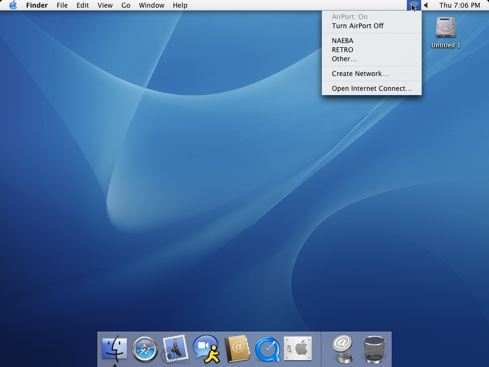

# P0.3.1 — essais Panther et restauration

## Environnement

29–30 octobre 2026, Panther 10.3.9 (7W98), PPC750, GCC 3.3/Xcode 1.5,
VM QEMU existante, vraie DWA-121 2001:3308 en EHCI 480 Mb/s. Ce n'est pas
une validation USB 1.1. Branche `v1/airport-p031`, base `8f28875`.
Aucun push autorisé dans cette mission.

## Construction et installation temporaire

Sur l'hôte : `sh scripts/test-host.sh` (C89/C++98, ASan/UBSan).
Dans Panther, depuis les sources complètes :

```sh
sh scripts/build-kernel-panther.sh
sh scripts/build-airport-panther.sh
WPA_BUILD_DIR=build/wpa sh scripts/test-wpa.sh
```

Le cœur expérimental porte 0.15.1, le compagnon 0.3.1 ; ces numéros identifient
les extensions locales, pas une publication. Les chemins de sortie existants
restent `build/DWA121Diagnostic.kext` et `build/airport-p02/`.
Pour le transfert ancien tar : `COPYFILE_DISABLE=1 tar --format ustar ...`.
Ne pas transférer les artefacts Apple, préférences, credentials ou network.conf.

Sauvegarde root 0700, hors `/tmp`, avant mutation :
`/var/root/dwa121-p031-backup/preferences.plist`. Ne jamais écraser une sauvegarde.
Arrêter le superviseur original, décharger les extensions locales précédentes.
Configurer le bundle **expérimental seulement** avec le canal initial connu,
PersistentRX, NetworkSessionEnabled et les options de connexion de la référence
(AssociationTXEnabled/WPA2ProbeEnabled/CCMPDataProbeEnabled pour la non-régression).
La configuration et le bundle installés dans `/Library/Application Support/DWA121`
ne sont pas remplacés. Ne pas lancer le superviseur original pendant ce chargement.

```sh
sudo chown -R root:wheel build/DWA121Diagnostic.kext build/airport-p02/DWA121AirPortP02.kext
sudo chmod -R go-w build/DWA121Diagnostic.kext build/airport-p02/DWA121AirPortP02.kext
sudo kextload build/DWA121Diagnostic.kext
sudo kextload build/airport-p02/DWA121AirPortP02.kext
build/airport-p02/dwa121-airport
build/airport-p02/dwa121-airport --scan
sudo build/airport-p02/airport-scan-test
build/airport-p02/scan-test
```

`kextload` peut revenir avant la calibration et l'apparition du compagnon :
attendre la présence de `AirPortDWA121` et `RadioRunning=Yes`. Un premier test
lancé trop tôt a échoué sur cette absence, puis a passé après l'initialisation.

Le test brut s'exécute radio non associée et sans autre client lançant un scan.
Il réserve brièvement le contrôle, sans authentification ni transmission, pour
vérifier le refus de scan sous propriétaire et le refus inverse pendant le scan.
Il vérifie aussi les tailles, canaris, index hors borne, absence de résultat avant
recherche et expiration après 16 secondes. Les autres cas synthétiques restent
exclusivement dans les tests C : aucun résultat synthétique n'entre dans AirPort.

Ajouter ensuite le service temporaire et conserver le relais au premier plan :

```sh
sudo build/airport-p02/dwa121-airport-service add
build/airport-p02/airport-service-test present
sudo build/airport-p02/dwa121-airport-monitor --watch
```

Ouvrir `/System/Library/CoreServices/Menu Extras/AirPort.menu`. Au besoin relancer
SystemUIServer. Ne pas sélectionner un SSID : association native, Other… et Create
Network… ne sont pas implémentés.

## Résultats matériels déjà obtenus

- Réception non associée avant modifications : 54 puis 75 balises en deux secondes.
- Premier balayage 550 ms/canal : 3 BSSID réels, mais timeout du framework avant
  la fin. Ce résultat n'a pas été compté comme intégration native réussie.
- 120 ms/canal avec réinitialisation complète : encore à la limite du timeout.
- Transition passive vérifiée, sans reconfiguration complète : `WirelessScan=0`,
  2,518 s mesurées, 11 canaux réellement programmés, retour au canal 11,
  `PassiveScanFailed=No`, `RXUSBErrors=0`.
- Recherches successives : deux puis trois BSSID, selon réception des balises.
  NAEBA : 2c:08:23:d6:3c:02 canal 6 et 58:1d:d8:78:bb:b8 canal 11.
  RETRO : 10:6f:3f:f0:71:cc canal 6. Plusieurs BSSID du même SSID restent distincts
  dans le résultat brut ; le menu natif les regroupe par SSID.
- Capture du vrai menu : « AirPort: On », « NAEBA », « RETRO », sans coche
  d'association inventée. La trace correspond à SystemUIServer et aux commandes
  8/9, pas à une interface personnalisée.
- Test transport PPC : PASS tailles/canaris, propriétaire exclusif dans les deux
  sens, trois BSSID réels, 23 consultations en cours, fin et expiration.
- Relance de SystemUIServer : menu et recherche fonctionnels.

Journaux de développement locaux ignorés : `artifacts/airport-p031/`.
Les tests unitaires couvrent aussi les IE tronqués/malformés, les doubles IE,
SSID cachés/vides/binaires/non ASCII/32 octets, saturation 16 BSSID, horloge 32 bits,
expiration et fautes avant/après chaque écriture de la porte RX passive.



La capture finale suit une demande de SystemUIServer (pid 920, commande 8,
34 octets, sortie 0), génération 2, balayage 1..11 puis retour au canal initial 6,
3 BSSID et 6 balises consolidées ; le compagnon livre 3 résultats natifs.
Le menu regroupe les deux BSSID NAEBA en une seule ligne. Un autre essai au canal
initial 6 mesure 2,658 s et vérifie `RXChannel=6` après la recherche.

Le dernier test brut, avec le filtre NUL ambigu refusé, donne 3 BSSID et 24
consultations en cours. L'annulation en cours livre la fin sur le même handle,
refuse un nouveau scan radio Off, et les commandes 13/18 confirment power=0.
La capture Off ne contient plus la liste de réseaux. Rechargement du cœur et du
compagnon : reprise des recherches et de l'affichage.

Les SSID cachés/non ASCII, l'absence physique de tout AP, les IE malformés et
l'extinction physique d'un AP n'ont pas été reproduits sur la radio de laboratoire.
Les cas de représentation, liste vide, expiration et parsing sont testés avec des
données contrôlées, distinctes des AP réels. Les cycles de chargement/déchargement
réussissent sans provider retenu ; aucune mesure exhaustive de fuite mémoire ni
endurance prolongée n'est revendiquée.

## Diagnostic

```sh
ioreg -c DWA121Diagnostic -w 0
ioreg -c AirPortDWA121 -w 0
dmesg | grep 'DWA121 scan'
build/airport-p02/dwa121-airport --scan
```

`start` côté compagnon identifie la réception native ; génération/Active côté
propriétaire identifient la planification ; `tuned passive channel` atteste RF
vérifié ; Beacons/BSSCount attestent la réception ; `end ... native=` indique la
traduction ; la capture du menu atteste l'affichage. Failed et DeniedOwner distinguent
une faute matérielle d'un refus de concurrence. Les compteurs RX sont ceux du
moteur courant, recréé à chaque canal ; les compteurs PassiveScan sont consolidés.
Les balayages annulés se terminent par la sentinelle de fin pour éviter la boucle
d'erreurs non bornée du framework. Aucun secret WPA2 n'est journalisé.

## Non-régression et restauration

Un premier essai avec le client **installé** obtient DHCP, DNS, 262144 octets
TCP dans chaque sens puis 27/30 pings. La session expire, RXUSBErrors=0 et TX
321/321, errors=0, drained=1. Cet essai n'est pas compté comme réussite des 30 pings.
Le défaut d'horloge hostap préexistant est décrit dans l'architecture ; le test
`mach_clock_test` reproduit l'échec de l'ancienne source à 738 secondes et passe
sur hôte et Panther avec la correction. Les suites station/WPA2/CCMP passent aussi.
Les avertissements GCC 3.3 « parameter has incomplete type » de l'amont restent
inchangés ; nos sources sont compilées avec `-Wall -Werror`.

Le client corrigé est compilé séparément, sans installation :

```sh
gcc -arch ppc -mcpu=750 -Wall -Werror -O2 \
 -DDWA_WPA2_PROBE -DDWA_NETWORK_BUILD src/config/config.c \
 -Ivendor/wpa_supplicant-2.12/src src/tools/dwa121-associate.c \
 src/rtl8188cu/tx.c build/wpa/libdwa-wpa2.a \
 -framework IOKit -framework CoreFoundation -o build/dwa121-connect
sudo build/dwa121-connect --config '/Library/Application Support/DWA121/network.conf'
```

Ce client utilise la configuration protégée existante sans l'afficher. Le
superviseur original reste arrêté pendant l'essai, car sa préparation chargerait
le bundle installé. Le cœur expérimental et le compagnon restent chargés.

Résultats avec le client corrigé et les extensions finales :

- Association WPA2/CCMP et DHCP `en2=10.12.89.127` ; la configuration initiale est conservée.
- Scan pendant la session : erreur native 0x88001003, `PassiveScanDeniedOwner=Yes`,
  canal 11 inchangé, session toujours active. Le refus est attendu et explicite.
- Routes vers passerelle 10.12.89.1 et serveur hôte 10.12.89.108 vérifiées sur **en2**,
  pas sur l'interface d'administration QEMU en1.
- **30/30 pings, 0 % de perte**, min/moy/max 15,385/59,101/178,086 ms.
- DNS avec source Wi-Fi : `dig -b 10.12.89.127 @10.12.89.1 example.com A`, NOERROR.
  Le DNS global de la VM n'a pas été modifié.
- TCP GET puis POST : **262144 octets dans chaque sens**, comparaison intégrale
  par le serveur de test local ; SHA-256
  `2312394bd99545d9de131c24efb781e765ac1aec243f2ed9347597a793a415e9`.
- Après trafic : RadioRunning et NetworkSessionActive vrais, RXUSBErrors=0.
  À l'arrêt : TX USB 349/349, RX USB sans erreur, AssociationTXErrors=0,
  PersistentStopVerified=Yes, WPA2KeysErased=Yes ; arrêt propre du client.

Restauration effectuée : processus de test arrêtés, service temporaire absent,
**toutes les valeurs de préférences restaurées (CFEqual)**, extensions expérimentales
déchargées. Le superviseur et le cœur **0.15.0** d'origine sont de nouveau actifs.
Retour réseau vérifié : DHCP, route en2, 5/5 pings, DNS et TCP 262144 octets dans
chaque sens avec contenu vérifié. Aucun compagnon `local.airportp02` chargé.
Le serveur HTTP temporaire de l'hôte est arrêté en fin de tâche.

Le correctif d'horloge reste dans les sources de cette branche et le client de
test ; la restauration ne l'applique pas rétroactivement au client v0.15.0 installé.
La référence conserve donc sa limitation de temporisation préexistante. Il faudra
construire/installer un paquet incluant ce correctif pour en bénéficier durablement.

Pour restaurer : arrêter proprement le relais, retirer seulement le service
possédé avec `dwa121-airport-service remove`, décharger le compagnon puis le cœur
expérimental, relancer `/usr/local/libexec/dwa121/dwa121-service start`.
Comparer les préférences sémantiquement sans les afficher :

```sh
sudo build/airport-p02/airport-preferences-test \
 /var/root/dwa121-p031-backup/preferences.plist \
 /Library/Preferences/SystemConfiguration/preferences.plist
build/airport-p02/airport-service-test absent
```

Ne pas réécrire aveuglément les préférences sauvegardées si des changements
étrangers existent. Vérifier les versions effectivement chargées et le réseau.
Aucun retrait USB QMP : le crash hôte observé pendant P0.2.1 reste distinct du pilote.

## Validation physique encore nécessaire

Sur le PowerBook G3 Lombard, conserver un moyen de retour à v0.15.0 et une copie
locale des journaux ; ne pas dépendre du Wi-Fi pour piloter le test. Sauvegarder les
préférences, compiler/installer temporairement comme ci-dessus. Radio non associée,
mesurer au moins dix scans, vérifier le délai du framework, les canaux, le retour
au canal initial et l'absence de nouvelles erreurs USB. Vérifier des AP connus
sur plusieurs canaux, SSID caché et non ASCII si un AP de laboratoire est disponible.
Redémarrer le compagnon et SystemUIServer, refaire un scan. Connecter ensuite avec
le mécanisme historique et vérifier refus de scan, DHCP, DNS, route DWA-121,
30 pings et TCP dans les deux sens. Retirer les services temporaires, comparer les
préférences et revenir à v0.15.0. USB 1.1, endurance et retrait physique restent
non validés tant que ces opérations n'ont pas été effectuées sur le matériel.
